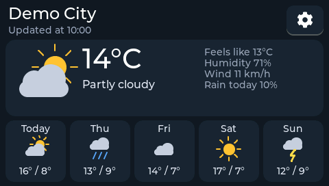
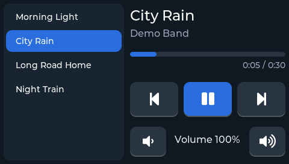
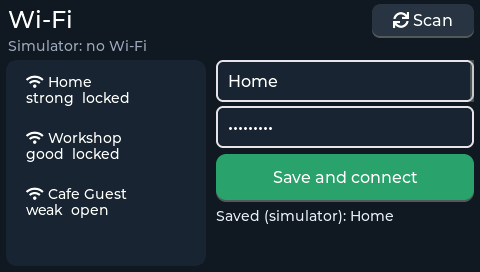

# copper-and-code-linux-boards

**Turn a Linux board into a MicroPython board with a touch screen, where the GUI and the operating
system work as one.** Write the GUI in Python with LVGL, use `mpremote` as on any MicroPython board,
and let every button reach what Linux can do: files, network, audio, GPIO, and every program the
board can run.

Website: **https://copper-and-code.github.io/copper-and-code-linux-boards/**

| | |
|---|---|
|  |  |
| [Weather](examples/weather): five days, drawn icons, night dimming | [Web radio](examples/web-radio): internet stations |
|  |  |
| [MP3 player](examples/mp3-player): songs from the SD card | [Settings](examples/settings): Wi-Fi for every app |

All these examples were built with [Copper and Code Studio](https://github.com/Copper-And-Code/copper-and-code-studio)
through its MCP tools: an AI assistant designed the screens, wrote the code, tried it in the
Studio's simulator and ran it on the board.

> A personal, experimental project for makers. It is not affiliated with, sponsored or endorsed by
> any of the manufacturers of the boards and chips it uses; their names only identify the hardware.

## Why: the GUI and the operating system, together

On a Linux board the graphical app and the system usually live apart. On one side a GUI toolkit
(Qt, GTK, a web page), on the other the programs and services of the system; between them, glue in
C++, D-Bus or shell scripts. That glue is where most makers stop.

copper-and-code-linux-boards puts the GUI **inside** the system. The screen is LVGL, written in Python, and the
same Python code reaches everything Linux can do:

| A touch on the screen... | ...uses the operating system |
|---|---|
| plays a song or an internet radio | `gst-play-1.0` (GStreamer), driven while it plays |
| shows the weather of the next days | `curl` in the background, the system clock |
| connects to a Wi-Fi network | `wpa_supplicant` and `systemd-networkd`, configured the standard way |
| runs a command, edits a file | a shell with real Linux programs on a pseudo-terminal, typed on a USB keyboard or a terminal on the PC |
| switches a LED, reads a button | the kernel's GPIO lines (`machine.Pin`) |
| powers the board off | `systemctl poweroff` |

And it works the other way round: the programs answer, and the GUI follows them live (the position
of a song, the state of the network, the output of a command) without ever freezing, because the
slow work runs in the background.

It is made for makers, so it keeps what makes microcontrollers easy:

- **The workflow of a MicroPython board.** A REPL on USB serial and TCP that `mpremote` and LVGL
  MPY Studio use as on any board (raw REPL, `cp`, `run`, `mount`), Ctrl-C, a soft reset in 0.2 s,
  safe mode on a button. No compositor, no cross-compiled C++, no image to rebuild for an app.
- **The same app on MCU and Linux.** The `display_driver` interface is the one of the MCU boards of
  [mpy-lvgl-boards](https://github.com/Copper-And-Code/mpy-lvgl-boards): an app for an RP2350 or an
  ESP32 runs unchanged on a Linux board with a bigger screen, and can then grow into Linux.
- **An appliance, not a desktop.** At power-on a shell on the display; a tap opens a menu of apps
  (weather, radio) and power off. The board becomes a device you build.
- **Apps written with an assistant, and checked.** Copper and Code Studio's MCP tools let an AI assistant
  write the glue between the GUI and the system; the simulator and the tests on the board check it.

## Copper and Code Studio and its MCP tools

[Copper and Code Studio](https://github.com/Copper-And-Code/copper-and-code-studio) designs LVGL screens by drag
and drop, runs them in a simulator and uploads them to the board. Import
`studio-board/boards/stm32mp135f_dk_480x272.json` in its board manager and the Linux board is one
more target.

The Studio also offers its tools through MCP, so an AI coding assistant can build a whole
application: add pages and widgets, write handlers and Python modules, render the pages, play
touch scripts in the simulator, upload to the board and read its console. That is how the MP3
player and the web radio here were made, and how a maker can go from "I want a radio with these
stations" to an app running on the board.

## Examples

| Example | What it shows |
|---|---|
| [settings](examples/settings) | Wi-Fi scan and connect, keyboard layout; saved in `settings.json`, where every app finds it |
| [weather](examples/weather) | Open-Meteo forecast for five days with drawn icons; settings page with night dimming |
| [mp3-player](examples/mp3-player) | Track list with ID3 titles, play, pause, next, volume: GStreamer driven from the GUI |
| [web-radio](examples/web-radio) | Internet radio stations, the same player for `http://` streams |
| [games](examples/games) | Your games full screen through libretro cores (SNES, C64, Neo Geo and arcade), chosen from an LVGL list: [mpy-retro](docs/retro.md) |
| [ftp-server](examples/ftp-server) | The SD card for FileZilla, WinSCP or a file manager: an FTP server in MicroPython, polled from the GUI's timer |
| [shell-linux](examples/shell-linux) | A terminal on the screen: shell, `vi`, `edit` and Linux programs on a pseudo-terminal |
| [stm32mp135f-dk](examples/stm32mp135f-dk) | The smallest Studio project: a button that answers to touch |

The audio examples need a sound card (a USB audio adapter is enough); the radio and the weather
need the internet, set up once with the Settings app.

## Boards

| Board | Status |
|---|---|
| STM32MP135F-DK (480×272, OpenSTLinux) | Tested: build, installation, REPL, display, touch, examples; `machine.Pin`, `I2C`, `ADC`, `PWM`, `SPI`, `UART` and `Timer` on Linux's own drivers ([notes](docs/machine-linux.md)) |
| STM32MP157C-DK2 (800×480, with a Cortex-M4) | Working: the same build, examples, Wi-Fi, sound; `machine.I2C`, `ADC`, `PWM`, `SPI`, `UART` and `Timer` served by the Cortex-M4 over RPMsg ([notes](docs/stm32mp157c-dk2.md)) |
| Other Linux boards | The Linux parts are generic; a port needs a build for its CPU (see below) |

What a Linux board needs: a panel or a monitor the kernel drives through DRM (RGB565 dumb buffer),
a touchscreen or a mouse through evdev, and a USB device port for the serial REPL (or only the
network for the TCP REPL). The display driver takes the resolution from DRM, prefers a monitor
connected at start (HDMI, DisplayPort) to the board's panel, and finds the first touchscreen, mouse
and backlight by itself; `MPY_DISPLAY_CONNECTOR`, `MPY_DISPLAY_MODE`, `MPY_TOUCH_NAME`,
`MPY_TOUCH_RANGE` and `MPY_BACKLIGHT` override them. A new
board then needs a unix variant in `boards/unix/` built with its toolchain, and its install script.

## Quick start (STM32MP135F-DK)

1. Flash OpenSTLinux and set up SSH: [installation guide](docs/stm32mp135f-dk-install.md).
2. Build and install from a Linux PC with the board's SDK in `work/sdk/`:

   ```sh
   scripts/build_mp135.sh lvgl
   scripts/build_mp135_usb.sh
   scripts/deploy.sh          # over SSH; reboot when it asks
   ```

3. The screen shows "MicroPython ready". Talk to it:

   ```sh
   mpremote connect /dev/ttyACM2 exec "import sys; print(sys.platform)"   # or socket://192.168.7.1:8266
   ```

   On a Linux PC with ModemManager (most desktops), install the board's udev rule once, or at
   every start of the board ModemManager probes its serial port with AT commands and the shell on
   the screen gets them as input:

   ```sh
   sudo cp linux/host/70-mpy-lvgl-board.rules /etc/udev/rules.d/ && sudo udevadm control --reload
   ```

4. Open an example in Copper and Code Studio and run it on the board.

`/usr/local/mpy/bin/mpy-uninstall` brings the original system back.

## How it works

```text
 PC: Copper and Code Studio / mpremote
        │ USB serial (CDC-ACM)        │ TCP over USB network
        └──────────────┬──────────────┘
                 mpy-repl-hub            one REPL for both, Ctrl-C as a signal, systemd watchdog
                       │ pseudo-terminal
     MicroPython unix port + LVGL 9.5    REPL like the MCU ports, soft reset by execve
       ├── display_driver ── linuxfb ──── DRM panel
       │                  └─ touch_evdev ─ touchscreen
       ├── machine.Pin ─────────────────── GPIO character device
       ├── machine.I2C, ADC, PWM, SPI, UART, Timer ─ RPMsg ─ Cortex-M4 (DK2)
       │                                 └─ i2c-dev, spidev, tty, PWM, IIO (no MCU)
       └── linuxproc ───────────────────── Linux programs (gst-play, shell, ...)
```

| Part | Where |
|---|---|
| MicroPython variant, frozen drivers | `boards/unix/`, `python/linux/` |
| C modules | `modules/mpyrepl`, `linuxfb`, `linuxproc`, `linuxmachine` |
| REPL hub | `tools/mpy-repl-hub/` |
| Cortex-M4 firmware (STM32MP157C-DK2) | `mcu/stm32mp157c-dk2/` |
| systemd units, USB gadget, install scripts | `linux/` |
| Games frontend (libretro), C64 core | `tools/mpy-retro/`, `cores/c64/`, `scripts/build_retro.sh` |
| Build and deploy | `scripts/` |
| Tests on the board, run from the PC | `tests/hil/` |
| Measurements and validation logs | `docs/`, `docs/log/` |

MicroPython, LVGL and the LVGL binding are used unchanged: everything here is an out-of-tree
variant, user C modules and frozen Python.

## What's next: the `machine` class, above all with an MCU on board

`machine` offers `Pin` on the kernel's GPIO lines and `I2C`, `ADC`, `PWM`, `SPI`, `UART` and
`Timer`: served by the Cortex-M4 on the STM32MP157C-DK2, by Linux's own drivers on the
STM32MP135F-DK and any board without a microcontroller, which needs only a description of its
connector ([machine on Linux's drivers](docs/machine-linux.md)). The plan is to port the rest of the
MicroPython `machine` API (`WDT`, `Pin.irq`) with the same names and behaviour as on the MCU ports, so that
hardware code moves between boards unchanged.

A board that pairs Linux with a microcontroller gets the best of both: Python and the GUI on
Linux, the real-time work on the MCU. On the STM32MP157C-DK2 `machine` talks to our firmware on the
Cortex-M4 over RPMsg (about 0.3 ms a request: [measured latency](docs/stm32mp157c-dk2.md#latency)), so a Python app
reads sensors with microcontroller timing while Linux keeps the screen, the network and the
programs. On boards without an MCU the same classes use the kernel's drivers, with Linux's timing.
See [the STM32MP157C-DK2](docs/stm32mp157c-dk2.md).

## Limits

Honestly, today:

- Two boards tested, both STM32MP1. The parts for other Linux boards are written but not tried on one yet.
- Start-up takes about 33 s on the stock OpenSTLinux image (a smaller image is planned).
- `machine` has `Pin`, `I2C`, `ADC`, `PWM`, `SPI`, `UART` and `Timer`; not yet `WDT` and `Pin.irq`: see what's next above. Without an MCU, timing is Linux's.
- No vsync: fast full-screen animations can tear.
- The TCP REPL has no password: it listens only on the USB network.

[Status, measurements and known issues](docs/stm32mp135f-dk.md).

## Credits

[MicroPython](https://micropython.org), [LVGL](https://lvgl.io) and the LVGL binding of
[PyDevices](https://github.com/PyDevices/lvgl-micropython) do the hard work; GStreamer plays the
audio of the examples.

## Website

The site is built from `docs/` with MkDocs Material, like the Copper and Code Studio site:

```sh
pip install -r requirements-site.txt
mkdocs serve          # preview
mkdocs gh-deploy      # publish on the gh-pages branch
```

## License

MIT, see [LICENSE](LICENSE). The font of `examples/shell-linux` is under the SIL Open Font License
([OFL.txt](examples/shell-linux/OFL.txt)).
