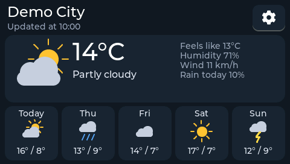
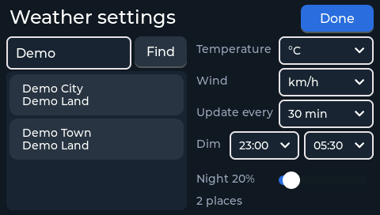
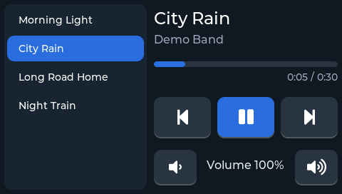
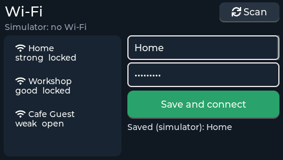

# Examples

Each example is an LVGL MPY Studio project (`project.json`, with its Python modules inside), made
with the Studio's MCP tools. Open it in the Studio, try it in the simulator (demo data stands in for
the network and the sound), connect to the board and run it. To have it in the home screen's menu,
add it to `settings.json`, section `home`.

Source: [examples on GitHub](https://github.com/Copper-And-Code/lvgl-mpy-linux/tree/main/examples).

## Weather

 

Weather now and for the next five days from [Open-Meteo](https://open-meteo.com) (no account, no
key), with icons drawn by LVGL objects from the WMO weather code: no image files. The settings page
finds the place by name and sets the units, the update interval and the night: by default the
backlight goes down to 20% from 23:00 to 05:30, in the place's own time. `curl` downloads in the
background, so the screen never waits.
[Source](https://github.com/Copper-And-Code/lvgl-mpy-linux/tree/main/examples/weather)

## Web radio

Internet radio stations, built in or from a `stations.txt`. GStreamer's `gst-play-1.0` plays the
stream in the background through `linuxproc.Process`; the app connects to the Wi-Fi of the Settings
app by itself. Needs a sound card: a USB audio adapter is enough.
[Source](https://github.com/Copper-And-Code/lvgl-mpy-linux/tree/main/examples/web-radio)

## MP3 player

The songs of the `music` folder, with titles and artists from their ID3 tags: play, pause, previous,
next, volume, progress. The same player module as the radio.
[Source](https://github.com/Copper-And-Code/lvgl-mpy-linux/tree/main/examples/mp3-player)

## Settings

Wi-Fi: scan, choose, type the password on the touch keyboard, connect. The choice goes to
`settings.json`, where every app finds it through `mpy_settings` and `mpy_wifi.ensure()`.
[Source](https://github.com/Copper-And-Code/lvgl-mpy-linux/tree/main/examples/settings)

## Shell

A terminal on the display, the home screen at power-on: built-in commands, the `vi` and `edit`
editors, Python programs and Linux programs on a pseudo-terminal, with the keyboard of the serial or
TCP terminal. A tap opens the app menu.
[Source](https://github.com/Copper-And-Code/lvgl-mpy-linux/tree/main/examples/shell-linux)
