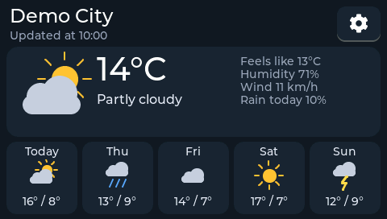
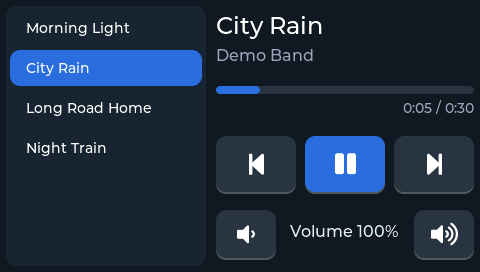
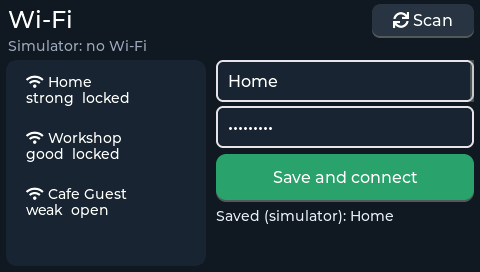

# lvgl-mpy-linux

**Turn a Linux board into a MicroPython board with a touch screen, where the GUI and the operating
system work as one.** Write the GUI in Python with LVGL, use `mpremote` as on any MicroPython board,
and let every button reach what Linux can do: files, network, audio, GPIO, and every program the
board can run.

<div class="shot-grid" markdown>
<figure markdown>

<figcaption>Weather: five days, drawn icons, night dimming</figcaption>
</figure>
<figure markdown>

<figcaption>Web radio: internet stations</figcaption>
</figure>
<figure markdown>

<figcaption>MP3 player: songs from the SD card</figcaption>
</figure>
<figure markdown>

<figcaption>Settings: Wi-Fi for every app</figcaption>
</figure>
</div>

All these apps were built with [LVGL MPY Studio](https://copper-and-code.github.io/lvgl-mpy-studio/)
through its MCP tools: an AI assistant designed the screens, wrote the code, tried it in the
Studio's simulator and ran it on the board.

> **Status: [mp135-v0.1](https://github.com/Copper-And-Code/lvgl-mpy-linux/releases/tag/mp135-v0.1).**
> One board tested, the STM32MP135F-DK. A personal, experimental project for makers, not affiliated
> with, sponsored or endorsed by any of the manufacturers of the boards and chips it uses; their
> names only identify the hardware.


## Why: the GUI and the operating system, together

On a Linux board the graphical app and the system usually live apart. On one side a GUI toolkit
(Qt, GTK, a web page), on the other the programs and services of the system; between them, glue in
C++, D-Bus or shell scripts. That glue is where most makers stop.

lvgl-mpy-linux puts the GUI **inside** the system. The screen is LVGL, written in Python, and the
same Python code reaches everything Linux can do:

| A touch on the screen... | ...uses the operating system |
|---|---|
| plays a song or an internet radio | `gst-play-1.0` (GStreamer), driven while it plays |
| shows the weather of the next days | `curl` in the background, the system clock |
| connects to a Wi-Fi network | `wpa_supplicant` and `systemd-networkd`, configured the standard way |
| runs a command, edits a file | a shell with real Linux programs on a pseudo-terminal |
| switches a LED, reads a button | the kernel's GPIO lines (`machine.Pin`) |
| powers the board off | `systemctl poweroff` |

And it works the other way round: the programs answer, and the GUI follows them live (the position
of a song, the state of the network, the output of a command) without ever freezing, because the
slow work runs in the background.

It is made for makers, so it keeps what makes microcontrollers easy:

- **The workflow of a MicroPython board.** A REPL on USB serial and TCP that `mpremote` and LVGL
  MPY Studio use as on any board (raw REPL, `cp`, `run`, `mount`), Ctrl-C, a soft reset in 0.2 s,
  safe mode on a button. No compositor, no cross-compiled C++, no image to rebuild for an app.
- **The same app on MCU and Linux.** The `display_driver` interface is the one of the MCU boards of
  [mpy-lvgl-boards](https://github.com/Copper-And-Code/mpy-lvgl-boards): an app for an RP2350 or an
  ESP32 runs unchanged on a Linux board with a bigger screen, and can then grow into Linux.
- **An appliance, not a desktop.** At power-on a shell on the display; a tap opens a menu of apps
  (weather, radio) and power off. The board becomes a device you build.
- **Apps written with an assistant, and checked.** LVGL MPY Studio's MCP tools let an AI assistant
  write the glue between the GUI and the system; the simulator and the tests on the board check it.

<div class="home-grid" markdown>
<div class="home-card" markdown>

## Get started

Install it on an STM32MP135F-DK running OpenSTLinux, then talk to it with `mpremote`.

[Getting started](stm32mp135f-dk-install.md){ .md-button .md-button--primary }

</div>
<div class="home-card" markdown>

## Examples

Weather, web radio, MP3 player, Settings and a shell on the screen, each a Studio project.

[See the examples](examples.md){ .md-button .md-button--primary }

</div>
<div class="home-card" markdown>

## How it is verified

Measurements, test results and known issues, with the logs of every check on the board.

[The STM32MP135F-DK](stm32mp135f-dk.md){ .md-button }

</div>
</div>

## LVGL MPY Studio and its MCP tools

[LVGL MPY Studio](https://copper-and-code.github.io/lvgl-mpy-studio/) designs LVGL screens by drag
and drop, runs them in a simulator and uploads them to the board. Import the board definition
(`studio-board/boards/stm32mp135f_dk_480x272.json`) in its board manager and the Linux board is one
more target.

The Studio also offers its tools through MCP, so an AI coding assistant can build a whole
application: add pages and widgets, write handlers and Python modules, render the pages, play
touch scripts in the simulator, upload to the board and read its console. That is how the examples
here were made.

## How it works

```text
 PC: LVGL MPY Studio / mpremote
        │ USB serial (CDC-ACM)        │ TCP over USB network
        └──────────────┬──────────────┘
                 mpy-repl-hub            one REPL for both, Ctrl-C as a signal, systemd watchdog
                       │ pseudo-terminal
     MicroPython unix port + LVGL 9.5    REPL like the MCU ports, soft reset by execve
       ├── display_driver ── linuxfb ──── DRM panel
       │                  └─ touch_evdev ─ touchscreen
       ├── machine.Pin ─────────────────── GPIO character device
       └── linuxproc ───────────────────── Linux programs (gst-play, curl, shell, ...)
```

MicroPython, LVGL and the LVGL binding are used unchanged: everything is an out-of-tree variant,
user C modules and frozen Python.

## Boards

| Board | Status |
|---|---|
| STM32MP135F-DK (480×272, OpenSTLinux) | Tested: build, installation, REPL, display, touch, GPIO, Wi-Fi, examples |
| STM32MP157C-DK2 (with a Cortex-M4) | Planned: `machine` served by the Cortex-M4 over RPMsg ([plan](stm32mp157c-dk2.md)) |
| Other Linux boards | The Linux parts are generic; a port needs a build for its CPU |

What a Linux board needs: a panel the kernel drives through DRM, a touchscreen through evdev, and a
USB device port for the serial REPL (or only the network for the TCP REPL).

## What's next: the `machine` class, above all with an MCU on board

Today `machine` offers `Pin`, on the kernel's GPIO lines. The plan is to port the rest of the
MicroPython `machine` API (`I2C`, `SPI`, `PWM`, `ADC`, `Timer`, `WDT`) with the same names and
behaviour as on the MCU ports, so that hardware code moves between boards unchanged.

The most interesting case is a board that pairs Linux with a microcontroller, such as the
STM32MP157C-DK2 with its Cortex-M4: Python and the GUI on Linux, the real-time work on the MCU.
There `machine` will talk to firmware on the Cortex-M4 over RPMsg, so a Python app can read sensors
and drive motors with microcontroller timing, while Linux keeps the screen, the network and the
programs. On boards without an MCU the same classes will use the kernel's drivers.
See the [plan for the STM32MP157C-DK2](stm32mp157c-dk2.md).

## Limits

Honestly, today:

- One board tested. The parts for other Linux boards are written but not tried on one yet.
- Start-up takes about 33 s on the stock OpenSTLinux image.
- `machine` has `Pin` only, for now: see what's next above.
- No vsync: fast full-screen animations can tear.
- The TCP REPL has no password: it listens only on the USB network.

MicroPython, LVGL and the LVGL binding of PyDevices do the hard work. MIT license.
