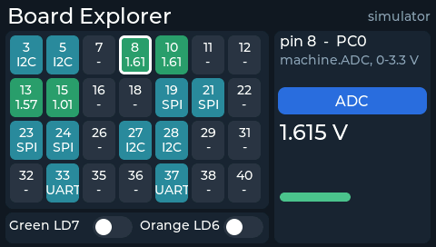

# machine on Linux's drivers



MicroPython's `machine` module, with the same API as on a microcontroller, on a board that has no
microcontroller beside its processor: `I2C`, `SPI`, `UART`, `PWM`, `ADC` and `Timer` go through
the Linux kernel's own drivers, `Pin` through the GPIO character device. The STM32MP135F-DK is the
first such board; any board running Linux with the usual drivers can follow with a description
file and no code.

On a board with a Cortex-M4 (the STM32MP157C-DK2) the M4 serves these classes instead
([mpy_m4](stm32mp157c-dk2.md)); `machine.py` picks the backend at import. The apps don't change:
`hasattr(machine, "PWM")` says whether the board has a class at all.

## The pieces

| Piece | Where | What it does |
|---|---|---|
| `machine.py` | `python/linux/`, frozen | MicroPython's `umachine` (with `Pin`), then the M4's classes where there is an M4, else those of `machine_kernel` the board describes |
| `machine_kernel.py` | `python/linux/`, frozen | the classes, on i2c-dev, spidev, the tty layer, the PWM and IIO frameworks, and a thread for `Timer` |
| `mpy_board.py` | `python/linux/`, frozen | reads the board's description; apps take the connector, the pins' names and the LEDs from it |
| the description | `linux/boards/BOARD.json`, installed as `/usr/local/mpy/board.json` | which bus, channel or line each name is |
| the device tree | `linux/stm32mp135f-dk-header.dtso` on the STM32MP135F-DK | turns on the peripherals of the expansion connector, for the kernel's drivers |
| `linux_delay.c` | `modules/linuxmachine/` | `time.sleep_ms()` that releases the GIL once per 10 ms (see below) |

Nothing writes the SoC's registers from user space: each class is the kernel's driver.

| Class | Kernel interface | Notes |
|---|---|---|
| `I2C(id)` | `/dev/i2c-N`, `I2C_RDWR` | combined transfers (`stop=False`, `readfrom_mem`); a device that doesn't answer is `OSError(ENODEV)`, as on a microcontroller; the speed is the device tree's `clock-frequency` |
| `SPI(id)` | `/dev/spidevB.C`, `SPI_IOC_MESSAGE` | modes 0 to 3, MSB or LSB first, 8 bits; the kernel drives the bus's chip select, a device on another line uses `Pin` |
| `UART(id)` | the port's tty, raw | Linux's standard rates (300 to 4,000,000 baud), 7 or 8 bits, parity, 1 or 2 stop bits; the kernel buffers what arrives meanwhile |
| `PWM(pin)` | `/sys/class/pwm` | `freq`, `duty_u16`, `duty_ns`, `invert`; the duty is the nearest the timer makes |
| `ADC(pin)` | IIO (`/sys/bus/iio`) | `read_u16` scaled to 16 bits, `read_uv` from the kernel's scale; `read_timed()` and `capture()` sample at a fixed rate kept by a hardware timer (an IIO trigger) and moved by DMA |
| `Timer(id)` | a thread on the monotonic clock | absolute deadlines, so the period doesn't drift; late expiries are counted in `missed` and made up in one call; periods from 1 ms |

## The board's description

One JSON file per board. The names are the kernel's platform devices (their bus address), found
in sysfs at each start, so the numbering the kernel happens to choose (`i2c-1`, `pwmchip4`) never
matters.

```json
{
  "board": "STM32MP135F-DK",
  "connector": {"name": "CN8", "title": "...", "pins": {"1": "3V3", "3": "PH6", "8": "PC0"}},
  "i2c": {"5": {"device": "4c006000.i2c", "scl": "PD1", "sda": "PH6"}},
  "spi": {"5": {"device": "4c003000.spi", "sck": "PH7", "mosi": "PH3", "miso": "PA8", "cs": "PH11", "cs_kernel": true}},
  "uart": {"8": {"device": "40019000.serial", "tx": "PE1", "rx": "PF9"}},
  "pwm": {"PB1": {"device": "40001000.timer", "channel": 3, "name": "TIM3 CH4"}},
  "adc": {"device": "48003000.adc", "bits": 12, "range_uv": 3300000, "pins": {"PC0": 0},
          "trigger": "tim6_trgo", "max_freq": 100000},
  "aliases": {"A0": "PC0"},
  "leds": {"green": {"pin": ["mcp23017", 14], "where": "LD7"}},
  "temperature": "cpu-thermal"
}
```

- `connector`: the pins as the board's connector numbers or names them; power pins by name
  (`3V3`, `5V`, `GND`). The apps draw it.
- `i2c`, `spi`, `uart`: by the number `machine` takes (`I2C(5)`), the device and its pins.
  `cs_kernel`: the chip select belongs to the kernel, it is no free GPIO line.
- `pwm`: by pin, the timer's device and the channel of its PWM chip.
- `adc`: the converter's device, its bits and full scale, the input pins and their channels; the
  trigger and the top rate for `read_timed()`.
- `aliases`: names a user knows the pins by (`A0`, `D6`); `machine` takes them too.
- `leds`: by colour, a GPIO line (a name, or `[chip, line]` of an expander), `"mcu": true` for one
  a microcontroller drives, or `"sysfs": NAME` for Linux's LED class; `active_low` when 0 lights it.

### A new board

1. The kernel's drivers on: the device tree enables the peripherals of the connector (an overlay
   like `linux/stm32mp135f-dk-header.dtso`) and, for SPI, a `spidev` child.
2. `linux/boards/BOARD.json`, from the device tree: the devices' addresses, and the pins of
   each function from the pin controller's groups.
3. `scripts/deploy.sh`: the board's compatible string names its DTB and description.
4. Check with a test like `tests/hil/t22_mp135_machine_kernel.py`.

Which pin is which ADC channel is in the chip's pin data: ST publishes it for every chip in
[STM32_open_pin_data](https://github.com/STMicroelectronics/STM32_open_pin_data) (`mcu/STM32MP135FAFx.xml`
for the STM32MP135F-DK's: the `ADC1_INPn` signals of each pin). Guessing it on the board is not
reliable: the ADC reads a pin only in analog mode, and a pull-up on a floating input leaves charge
that the next channel's conversion picks up. So the device tree puts the ADC's pins in analog mode
(a pin control group of the ADC), which takes them from the GPIO lines, as on a microcontroller.

## STM32MP135F-DK

The 40-pin GPIO expansion connector CN8 (numbered as on a Raspberry Pi):

| Function | Pins | `machine` |
|---|---|---|
| I2C5 | 3 SDA (PH6), 5 SCL (PD1) | `I2C(5)`, 400 kHz, shared with the board's MIPI bridge (0x14) and touch controller (0x5d) |
| I2C1 | 27 SDA (PE8), 28 SCL (PD12) | `I2C(1)`, the board's own devices (expander, USB-C controller) |
| SPI5 | 19 MOSI (PH3), 21 MISO (PA8), 23 SCK (PH7), 24 CS (PH11) | `SPI(5)` |
| UART8 | 37 TX (PE1), 33 RX (PF9) | `UART(8)` |
| PWM | 7 (PB1, TIM3 CH4), 31 (PD13, TIM4 CH2), 32 (PE5, TIM8 CH3) | `PWM("PB1")` |
| ADC1 | 8 (PC0, channel 0, `A0`), 10 (PB0, 9, `A1`), 13 (PC3, 13, `A2`), 15 (PF13, 11, `A3`) | `ADC("A0")`, 0 to 3.3 V, 12 bits |
| GPIO | the others | `Pin("PA0")` |
| LEDs | LD7 green, LD6 orange (MCP23017 IO14, IO15) | `Pin(("mcp23017", 14))` |

What is left off, and why:

- TIM1's PWM is the panel's backlight; TIM14 (pin 33) would take UART8's RX.
- USART1 (pins 8 and 10) would also take pins 11 and 36 for RTS and CTS, and pin 8 is an ADC input.
- ADC2, with the chip's internal channels (`vrefint`, the supplies), belongs to the secure world:
  the kernel is refused it (`EACCES` from the ETZPC firewall). So there is no `ADC.CORE_VREF` here;
  `ADC.CORE_TEMP` neither, the CPU's temperature is Linux's (`/sys/class/thermal`).
- TIM6, a basic timer, is the ADC's sampling clock (`tim6_trgo`), apart from the PWM timers.

Measured on the board (`tests/hil/t22_mp135_machine_kernel.py`; the last rows with wires on CN8,
`MACHINE_LOOPBACK`):

| What | Result |
|---|---|
| `I2C(5).scan()` | 0x14, 0x5d; an empty address raises `ENODEV` |
| `ADC("A0").read_timed()` | 1,000 samples at 10 kHz in 124 to 136 ms |
| an ADC reading through the kernel | about 0.36 ms (System Monitor) |
| `Timer(period=10)` | 9.75 to 10.2 ms apart idle; with the GUI drawing, 92% within 0.5 ms, the longest interval about 47 ms (Timing Lab) |
| SPI5, pins 19 to 21 | the bytes sent come back |
| UART8, pins 37 to 33 | the line sent comes back |
| PWM pin 7 to A0 (pin 8), steady | 3.299 V high, 0.000 V low |
| PWM 20 kHz to A0, `read_timed()` at 97 kHz | 0.250, 0.498, 0.748 of the samples high for 25, 50 and 75% |

## Timing on Linux

Linux decides when a thread runs, the `Timer`'s as any other; a microcontroller does not share that
limit. On the STM32MP157C-DK2 the M4 keeps the time and Linux only runs the callbacks; on a board
without one, nobody keeps it apart from Linux. Timing Lab shows the difference: with the GUI drawing
on a single core, the `Timer` thread and a thread calling `time.sleep_ms(10)` spread alike, the
count of expiries stays whole.

Two things in MicroPython's Unix port made it worse, and are handled here:

- `time.sleep_ms()` slept in steps of 0.5 ms and took the GIL back after each one: 20 times for
  10 ms. On a single core each of those waited for the thread holding the GIL, and a thread's
  `sleep_ms(10)` took 33 ms on average and up to 640 ms. `modules/linuxmachine/linux_delay.c`
  sleeps in steps of up to 10 ms, the GIL released for each, Ctrl-C and scheduled callbacks still
  handled between steps: 10.7 ms on average, 13 ms at most, measured the same way.
- `time.sleep_us()` keeps the GIL while it sleeps: other threads wait. The `Timer` thread sleeps
  with `sleep_ms()` and uses `sleep_us()` only for the last fraction of a millisecond. A program's
  own threads should do the same for any sleep longer than a millisecond.
