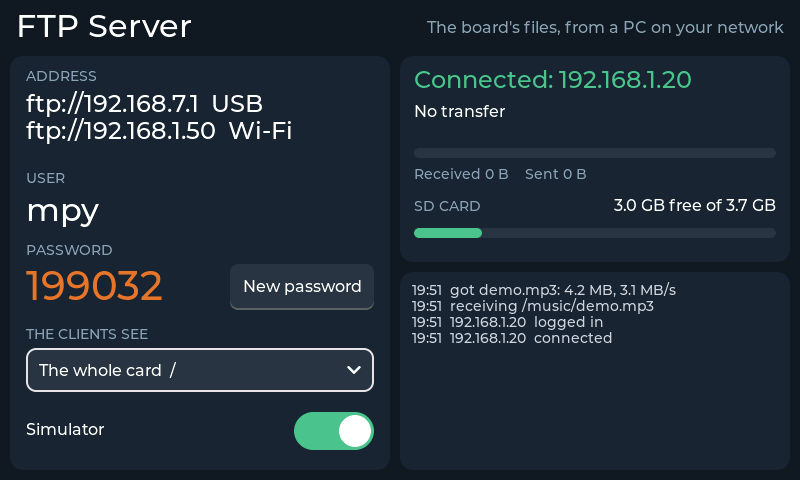

# FTP Server

The board's files for a PC on the same network: the whole SD card, the MicroPython folder or the
Studio apps, with FileZilla, WinSCP, Windows Explorer, the file manager of Linux or macOS, `curl`,
`lftp` or `ftp`. Copy, download, rename, delete, make and remove folders, resume a broken transfer.
Made with Copper and Code Studio and its MCP tools.

The screen shows the addresses (`ftp://192.168.7.1` over the USB cable, and the Wi-Fi's), the user
`mpy` and the password, who is connected, the file moving and its speed, the free space on the card
and a log. The password is made at the first start and kept in `settings.json`, section `ftp`,
with the folder: a client that saved them connects again after a restart. **New password** makes
another one and logs everyone out.

The server is MicroPython (`ftp_server`), polled from the GUI's timer every 20 ms: commands are
answered at once, files move in pieces for 10 ms of each tick, so the screen keeps its pace during
a long copy. Passive (`PASV`, `EPSV`) and active (`PORT`, `EPRT`) data connections, listings as
`ls -l` (`LIST`) and with exact times (`MLSD`), `REST`, `SIZE`, `MDTM`, up to 8 clients at once.
Measured on the STM32MP157C-DK2 over the USB network with a 50 MB file: 4.4 MB/s to the SD card,
6 MB/s from it.

**Security.** Plain FTP: the password and the files cross the network in clear, and the clients log
in as root. Use it on your own network, and switch it off when you are done. Three wrong passwords
close the connection; active connections go only to the client's own address.

## Try it

- On the board: open `project-800x480.json` (STM32MP157C-DK2) or `project.json` (STM32MP135F-DK)
  in Copper and Code Studio and run it. To have it in the home screen's menu, add it to `settings.json`:
  `{"name": "FTP", "path": "/lms_apps/app_.../app_main.py"}` in `home.apps`.
- From the PC over the USB cable: `ftp://mpy@192.168.7.1/`, or
  `curl --user mpy:PASSWORD ftp://192.168.7.1/usr/local/mpy/fs/`.
- In the simulator there is no server; the screen shows made-up clients.

## Files

| Module | What it does |
|---|---|
| `ftp_server` | the FTP server: sessions, commands, data connections, transfers in pieces |
| `ftp_app` | the screen: addresses, password, folder, clients, transfer, card, log |
