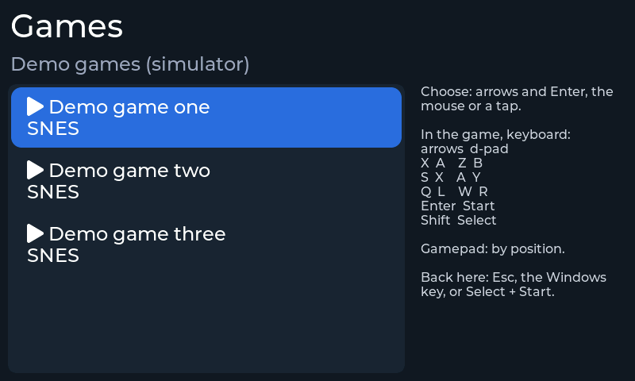

# Games



Your games, full screen, through libretro cores. The list is an LVGL app made with Copper and Code Studio
and its MCP tools; the game is `mpy-retro`, a frontend in C, which has the screen, the sound and the
keyboard while it runs. When the game ends the list comes back. On the STM32MP157C-DK2 (800×480,
`project-800x480.json`): SNES through Snes9x2005 and the C64 through the core of `cores/c64`, at
full speed with every frame drawn; Neo Geo and arcade through FBNeo (romsets as FBNeo names them,
the Neo Geo BIOS `neogeo.zip` next to the games), most of them at full speed, the heaviest with a
frame skipped now and then (see the frontend's notes). On the STM32MP135F-DK (480×272,
`project.json`, the keys in short beside the list) SNES games run with room to spare, about three
times the speed they need; those with a Super FX chip, the heaviest, now and then a little late.

## Setting up

1. Build the frontend and the cores, then deploy: `scripts/build_retro.sh` and `scripts/deploy.sh`.
2. Copy your games into `/usr/local/mpy/fs/games` on the board, one folder per system if you like:

   ```sh
   mpremote connect /dev/ttyACM1 mkdir :games/snes
   mpremote connect /dev/ttyACM1 cp "My game.sfc" :games/snes/
   ```

   No game comes with the board or this repository: use dumps of cartridges you own. The C64 also
   needs its ROMs, yours too, in `/usr/local/mpy/retro/system/c64/` (see `cores/c64/README.md`).
3. Upload this project from the Studio and add it to the home menu (`settings.json`, section `home`).

## Playing

| | Keyboard | Gamepad (USB or Bluetooth) |
|---|---|---|
| Choose a game | left and right change system, up and down and Enter; or the mouse, or a tap | the same with the d-pad, A to play; the shoulders change system too |
| D-pad | arrows | d-pad, hat or left stick |
| A, B, X, Y | X, Z, S, A | east, south, north, west buttons |
| L, R | Q, W | shoulders |
| Start, Select | Enter, Shift | Start, Select |
| Back to the list | Esc or the Windows key | Select and Start together, or the home button |

On the C64 the keyboard is the C64's (Esc is RUN/STOP), the joystick is in port 2 (gamepad, or
keypad 8 4 6 2 and 0; Select moves it to port 1), and the Windows key comes back. A `.d64` disk loads
and runs by itself, a `.prg` BASIC program runs, a `.crt` cartridge starts. The panel on the right of
the list shows the keys of the system of the chosen game.

The sound goes to the headphone jack, or to HDMI on a monitor; on the STM32MP135F-DK, which has no
sound of its own, to a USB audio adapter. The save RAM is kept next to the game,
as `GAME.srm`. A keyboard or a gamepad plugged in during the game works at once.

## How it works

`games_app.py` lists the games with `mpy_retro.games()` and starts one with `mpy_retro.play(path)`,
which releases the screen (`display_driver.release()`), runs `mpy-retro CORE.so GAME` through
`linuxproc.Process` and takes the screen back (`display_driver.resume()`). The REPL hub lends the
keyboards to the frontend while it runs. The arrows and Enter of the list come from `mpy_keys`.

In the Studio simulator three demo names stand in for the games.
