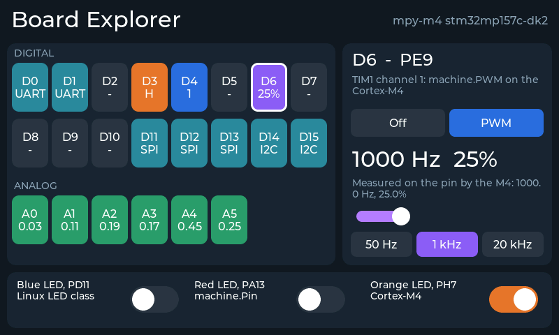

# Board Explorer

The STM32MP157C-DK2's Arduino connector on the screen, made with LVGL MPY Studio and its MCP tools.
Tap a pin and choose what it does; its value is live. Nothing needs to be wired.

| Pins | What you can do | Served by |
|---|---|---|
| D2, D3, D4, D5, D7, D8, D9, D10 | input, input with pull-up, output | Linux GPIO lines (`machine.Pin`); for an output, the Cortex-M4 reads back the level the pin really has |
| D6 | PWM at 50 Hz, 1 kHz or 20 kHz, duty 0 to 100% | the M4's TIM1 (`machine.PWM`), measured on the pin by the M4 (`mpy_m4.measure`) |
| A0 to A5 | voltage, 0 to 2.5 V | the M4's ADC (`machine.ADC`); unwired inputs float |
| D14, D15 | scan of the I2C bus | `machine.I2C(5)` on the M4 |
| D11 to D13, D0, D1 | (SPI4, UART7) | shown; used through `machine.SPI(4)` and `machine.UART(7)` |

The three LEDs come from three places: the blue one (PD11) through Linux's LED class
(`/sys/class/leds/heartbeat`: off gives its blinking back to the kernel), the red one (PA13)
through `machine.Pin`, the orange one (PH7) through the Cortex-M4. The green LED (PA14) is also the
USER1 button, whose interrupt the device tree gives the M4: Linux may read that pin but not drive
it.

## On the board

Open `project.json` in LVGL MPY Studio, connect to the STM32MP157C-DK2 and run it. The first use of
the M4 starts its firmware (about half a second).

## Files

| Module | What it does |
|---|---|
| `board` | the connector's pins and what serves them; the hardware, or the simulator's stand-in |
| `explorer_app` | the screen: pin buttons, modes, values, LEDs; updates from the page's timer |
