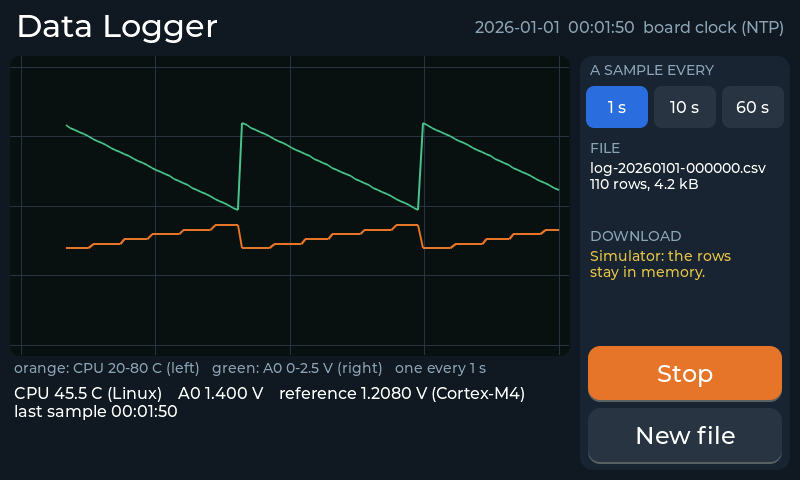

# Data Logger



A data logger on the STM32MP157C-DK2, made with Copper and Code Studio and its MCP tools. Nothing to wire
to start with: it logs the CPU's temperature, the voltage on A0 and the chip's internal reference.

Each part does what it does best:

- the pace: a timer of the Cortex-M4 (`machine.Timer`), every 1, 10 or 60 seconds;
- the values: the CPU's temperature from Linux (`/sys/class/thermal`), A0 and the reference from
  the M4's ADC;
- the file: a CSV in `logs/` (`/usr/local/mpy/fs/logs` on the board), dated by the board's clock,
  which NTP sets once the board is online;
- the chart: the last 120 samples, the temperature on the left scale, A0 on the right;
- the download: `http://BOARD:8081/log.csv?k=PIN`, with the PIN shown on the screen.

Checked on the board: 41 rows in 41 seconds, one each second without a gap, dates from the
network's clock; the CSV downloaded with `curl` over the USB network (403 without the PIN).

```text
time,cpu_c,a0_v,vref_v
2026-11-18 09:54:44,28.7,0.0198,1.2081
2026-11-18 09:54:45,28.6,0.0082,1.2066
```

To log something of your own, wire a sensor's output to A0 (0 to 2.5 V), or change `sensors.py`:
an I2C sensor through `machine.I2C(5)` is one more field.

## On the STM32MP135F-DK

`project.json` (480×272). The pace is `machine.Timer` on Linux's clock and A0 is pin 8 of the
40-pin connector (PC0), 0 to 3.3 V, through Linux's ADC driver
([machine on Linux's drivers](../../../docs/machine-linux.md)). Its ADC has no internal reference
Linux may read, so the `vref_v` column stays empty. `project-800x480.json` is the
STM32MP157C-DK2's.

## Files

| Module | What it does |
|---|---|
| `sensors` | the samples, at the pace of the M4's timer; made up in the simulator |
| `storage` | the CSV file |
| `fileserver` | the file for a browser |
| `logger_app` | the screen: chart, file, controls |
