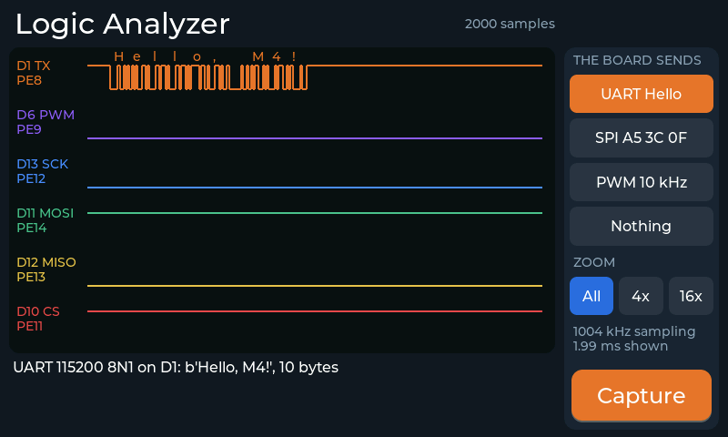
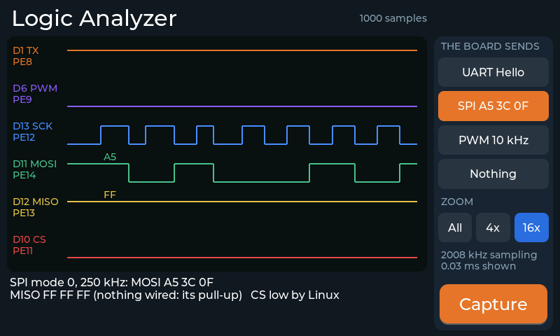

# Logic Analyzer

A logic analyser on the STM32MP157C-DK2's screen, made with Copper and Code Studio and its MCP tools, that
needs no wires: it watches the board's own buses.

The Cortex-M4 samples all 16 pins of GPIO port E at a fixed rate, up to 4 MHz, timed by its cycle
counter (`mpy_m4.logic_capture`). Port E carries UART7 (D0, D1), the PWM (D6), SPI4 (D11 to D13)
and D10, the chip select that Linux drives. While it samples, the M4 itself starts the signal to
watch, from the first bit: a UART message, an SPI transfer (between two samples it feeds the
buses), or the PWM. Python on Linux then decodes the samples (`decoders`: UART 8N1, SPI mode 0, PWM)
and draws one row a pin, with the decoded bytes above the traces.

| The board sends | Seen and decoded on the board |
|---|---|
| UART7 at 115200, "Hello, M4!" | `b'Hello, M4!'`, each character over its frame |
| SPI4 at 250 kHz, A5 3C 0F | MOSI A5 3C 0F; MISO FF (its pull-up, nothing wired); CS low (Linux) |
| PWM on D6, 10 kHz 30% | 10000.1 Hz, 30.0% high |

Wire something to D0 to D13 and "Nothing" shows it as it is. Zoom: 4x and 16x start just before
the first activity.

## Files

| Module | What it does |
|---|---|
| `analyzer` | the channels, the captures and their signals on the board; made-up signals in the simulator |
| `decoders` | UART, SPI and PWM from the samples, in plain Python |
| `la_app` | the rows, zoom, decoded bytes |
