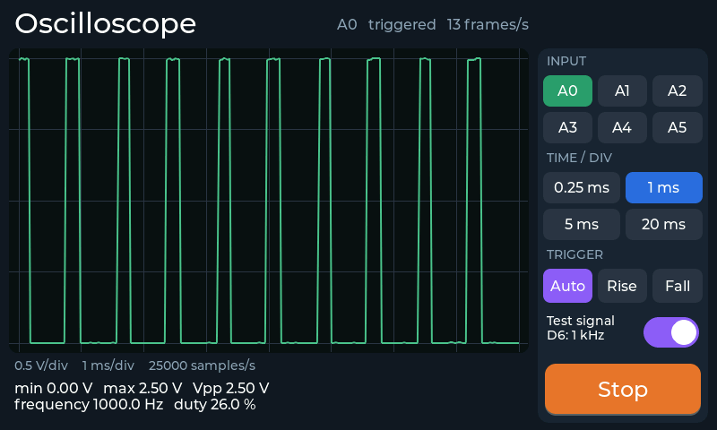
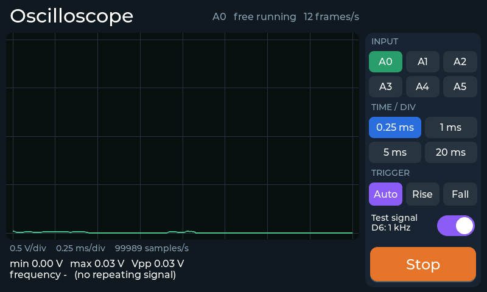

# Oscilloscope

An oscilloscope on the STM32MP157C-DK2's screen, made with LVGL MPY Studio and its MCP tools: one
of the analog inputs A0 to A5, 0.25 to 20 ms a division, trigger on a rising or falling edge,
minimum, maximum, peak to peak, frequency and duty. A switch turns on a test signal, a 1 kHz PWM
at 25% on D6.

Linux alone could not do this: its sampling would jitter with everything else the board does.
Here the Cortex-M4's TIM2 triggers every conversion in hardware, up to 100,000 samples a second,
and Python on Linux only starts a capture, collects it when it is done and draws it, from the
page's timer, so the screen never waits (`ADC.capture()`, `capture_done()`, `capture_read()`, the
steps of `ADC.read_timed()`).

## Try it

1. Open `project.json` in LVGL MPY Studio. In the simulator, A0 shows the test signal when it is on
   and A1 a 50 Hz sine.
2. On the board: one wire from **D6 to A0** on the Arduino connector, turn the test signal on: a
   1 kHz square wave, measured at 1000 Hz and 25%. Without the wire the inputs float near 0 V.
3. Inputs take 0 to 2.5 V (the ADC's reference); never more than 3.3 V. D6's PWM swings 0 to 3.3 V,
   so its top shows at 2.5 V, the end of the scale.

Measured on the board: 12 frames a second at 0.25 ms and 1 ms a division (500 samples a capture,
twice the screen, so a trigger can be found), 2 at 20 ms a division (each capture takes 0.4 s);
the whole board about 28% busy.

## Files

| Module | What it does |
|---|---|
| `probe` | captures on the board through `machine.ADC`, the test signal through `machine.PWM`; in the simulator, made-up signals |
| `scope_app` | capture cycle, trigger with hysteresis, measurements, the chart, the controls |
