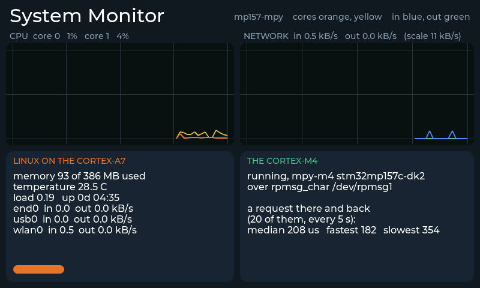

# System Monitor

The STM32MP157C-DK2's two halves, live, made with LVGL MPY Studio and its MCP tools. Nothing to wire.

| Linux on the Cortex-A7 | The Cortex-M4 |
|---|---|
| each core's load (`/proc/stat`), memory (`/proc/meminfo`), temperature (`/sys/class/thermal`), traffic of each network interface (`/proc/net/dev`), load average, uptime | remoteproc's state, the firmware, the channel in use (`rpmsg_char` or the serial port), 20 requests there and back every 5 seconds: median, fastest, slowest |

Charts: the two cores over the last minute, and the network's in and out with a scale that
follows the traffic.

On the board (above): memory 93 of 386 MB, 28.5 C, the M4 over `rpmsg_char` at a 208 us median.
Everything Linux knows is a file away from Python, so a monitor is a page of code; what the M4 adds
is its own state and the cost of talking to it.

## Files

| Module | What it does |
|---|---|
| `probes` | the readings from Linux's files and from the M4; made up in the simulator |
| `monitor_app` | the charts and the two panels |
