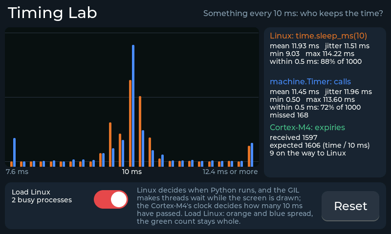

# Timing Lab

Something every 10 ms, three ways, on the STM32MP157C-DK2, made with LVGL MPY Studio and its MCP
tools. Nothing to wire.

| Colour | What | Who keeps the time |
|---|---|---|
| orange | a Python thread that calls `time.sleep_ms(10)` | Linux wakes it up |
| blue | the callbacks of `machine.Timer(period=10)` | the Cortex-M4 counts, Linux calls |
| green | the expiries the M4 counted, against the time gone by | the M4 |

The histogram shows the intervals between two runs, from 7.6 to 12.4 ms; the panel their mean,
spread and extremes. The switch starts two busy Linux processes (`linuxproc`, one for each Cortex-A7
core); Reset starts counting again.

## What it shows

Measured on the board:

| | idle | two busy processes |
|---|---|---|
| `sleep_ms(10)` | mean 10.81 ms, max 63 ms, 94% within 0.5 ms | mean 11.9 ms, max 114 to 130 ms, 88% |
| `machine.Timer` calls | 90% within 0.5 ms | 72 to 77% within 0.5 ms, more expiries merged (`missed`) |
| expiries counted by the M4 | all: 2 to 8 on their way to Linux | all: up to about 13 on their way |

- Even idle, Linux stretches some intervals to tens of milliseconds: while LVGL draws the screen its
  thread holds MicroPython's GIL, and the other threads wait.
- Under load the spread doubles.
- The M4 loses nothing: over 80 seconds and 8300 expiries the count stayed within 2 to 6 of the
  time gone by (those still on their way, not lost), with no drift.
- Hence the rule of the board: what must happen at an exact time runs on the M4 (PWM, the ADC's
  sampling, counting); Python on Linux decides, shows and talks.

In the Studio simulator the intervals are made up, of the same kind.

## Files

| Module | What it does |
|---|---|
| `clocks` | the three ways and the load on the board; in the simulator, made-up intervals |
| `timing_app` | histogram, statistics, the M4's count |
