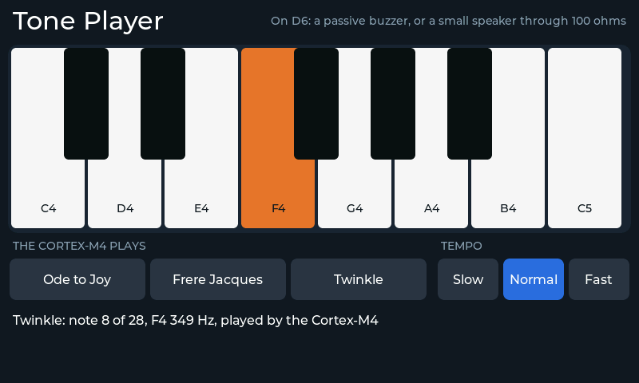

# Tone Player

A keyboard and a music box on the STM32MP157C-DK2, made with Copper and Code Studio and its MCP tools. The
sound comes out of D6 as a square wave: a passive buzzer between D6 and GND, or a small speaker
through a 100 ohm resistor.

- Hold a key: the note sounds until you let go, and the Cortex-M4 measures it on the pin
  (A4: 440 Hz asked, 440.0 Hz measured).
- Tap a tune (traditional, public domain: Ode to Joy, Frere Jacques, Twinkle Twinkle): Python sends
  the whole score at once, up to 100 notes (`mpy_m4.play`), and the M4 plays it on time by itself
  while it goes on answering Linux. The key of each note lights up as the M4 plays it
  (`mpy_m4.playing`).

Music is where a few milliseconds of delay can be heard: here no note depends on when Linux gets
round to Python.

Checked on the board without a buzzer: the M4 measures every note on the pin (262, 440, 1319 and
4186 Hz to the hundredth, in 30 ms; `tests/hil/test_m4.sh` plays a tune and checks each note).

## Files

| Module | What it does |
|---|---|
| `music` | notes to frequencies, the tunes, the instrument (the M4, or a silent stand-in in the simulator) |
| `player_app` | the keyboard, the tunes, the tempo, the lit keys |
