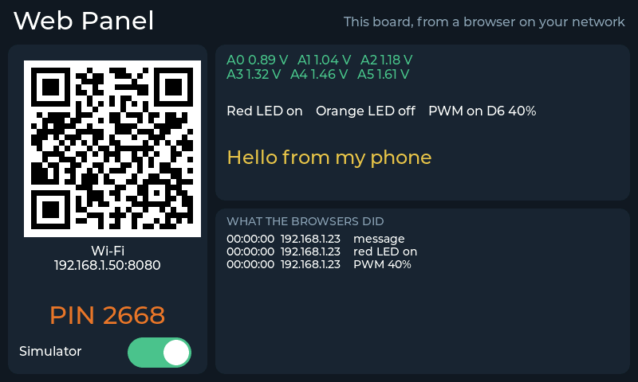

# Web Panel

The STM32MP157C-DK2 serves a page to the browsers of its network, made with LVGL MPY Studio and its
MCP tools. Scan the QR code with a phone on the same Wi-Fi (or open the address), type the PIN
shown on the screen, and:

- see the analog inputs A0 to A5 live (the Cortex-M4's ADC);
- switch the red LED (a Linux GPIO line) and the orange one (the M4);
- set the PWM on D6 (1 kHz, the M4's TIM1);
- send a message to the board's screen.

The board's screen shows the address, the PIN, the values and what each browser did. The server is
a few lines of MicroPython (`server`), polled from the GUI's timer every 20 ms: it never blocks the
screen. Over the USB network a request takes about 16 ms there and back (`curl` from the PC:
median 15.7 ms, at most 26 ms); the page is 2.4 KB.

**Security.** Anyone on the network can reach the board: the PIN, new at each start, keeps a
passer-by out, no more. Plain HTTP, no accounts: use it on your own network.

## Try it

- On the board: the board needs its network (the Settings app); open `project.json` in LVGL MPY
  Studio and run it. Over the USB cable the PC reaches it at `http://192.168.7.1:8080/?k=PIN`.
- In the simulator there is no server; the screen shows made-up values.
- From a script: `curl "http://BOARD:8080/api/state?k=PIN"` (JSON),
  `curl "http://BOARD:8080/api/set?k=PIN&duty=40"` (also `red=1`, `orange=0`, `message=...`).

## Files

| Module | What it does |
|---|---|
| `server` | the HTTP server, the page, the PIN |
| `board_io` | inputs, LEDs, PWM and addresses through `machine`; made-up values in the simulator |
| `panel_app` | the screen: QR code, PIN, values, the browsers' log |
