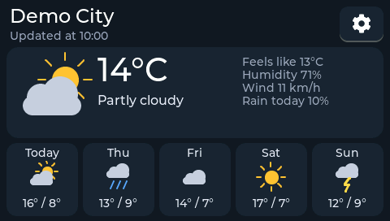
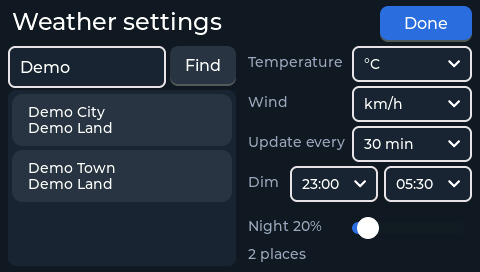

# Weather

Weather now and for the next five days, with drawn icons, made with LVGL MPY Studio and its MCP
tools. Data from [Open-Meteo](https://open-meteo.com): no account and no key, free for
non-commercial use.

 

- **Main page**: place, time of the last update, the weather now (icon, temperature, description,
  feels-like temperature, humidity, wind, chance of rain) and five days (icon, highest and lowest).
  Tap the big panel to update at once.
- **Settings** (the gear): find the place by name, temperature in °C or °F, wind in km/h, m/s, mph
  or knots, update every 15, 30 or 60 minutes, and the night: from when to when the backlight goes
  down (by default from 23:00 to 05:30) and how much (by default 20%). During the night a tap on the
  big panel brings full brightness back for a minute.

The settings go to the `weather` section of `settings.json`, next to the Wi-Fi of the Settings app.
At start the app connects to that Wi-Fi (`mpy_wifi.ensure()`); `curl` downloads in the background,
so the screen never waits. Night times are the place's own: the offset from UTC comes with the
forecast, so the board's time zone does not matter.

The icons are LVGL objects (circles, rounded boxes, lines) drawn from the WMO weather code, at any
size, with no image files. In the Studio simulator, where there is no network, demo places and a
demo forecast are used.

| Module | What it does |
|---|---|
| `weather_icons` | `icon(parent, code, x, y, size)`, `describe(code)` |
| `weather_data` | Open-Meteo requests in the background, the app's settings |
| `weather_app` | both pages, updates, night dimming |
